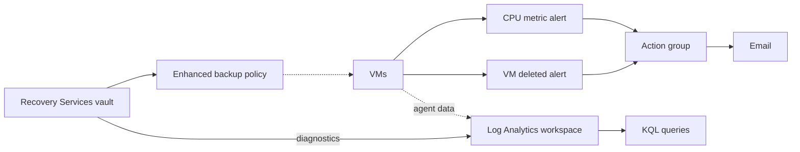

# Azure Monitoring Baseline

[](https://github.com/rahmantj93/azure-monitoring/actions/workflows/bicep-build.yml)

A Bicep template that gives a resource group a monitoring and backup baseline: a Log Analytics workspace, alerts that email an operations address, a Recovery Services vault with an Enhanced backup policy, and vault diagnostics that feed Backup reports. The `queries/` folder holds the KQL used to investigate what the alerts surface.

## Architecture



Dotted lines are set up per VM and are not created by this template: assigning VMs to the backup policy, and sending their data to the workspace with the Azure Monitor Agent.

## Design decisions

- **Alerts are scoped to the resource group, not to single VMs.** Any VM added to the group is covered automatically, with no rule to update.
- **VM deletion uses an Activity Log alert, not a metric alert.** A deletion is a control-plane event recorded in the Activity Log, and a deleted VM stops emitting metrics.
- **The alert email is a parameter.** No personal address is stored in a public repository.
- **The backup policy is Enhanced (V2), every 4 hours.** Enhanced policies allow several backups per day and are required for Trusted Launch VMs.
- **The vault uses LRS because this is a lab.** Production would use GRS with Cross Region Restore. Redundancy must be chosen up front, because it locks once the first item is protected.
- **Vault diagnostics use resource-specific (Dedicated) mode.** Backup reports require it, and it writes to the `AddonAzureBackup*` tables that `backup-failures.kql` queries.

## Queries

| File | What it answers |
|---|---|
| `queries/missing-heartbeat.kql` | Which VMs' agents haven't reported for 15 minutes or more |
| `queries/cpu-avg-by-hr.kql` | Average CPU per VM, per hour |
| `queries/vm-deleted-by.kql` | Who deleted a VM, and when |
| `queries/syslog-errors.kql` | Error-level Syslog messages per VM in the last 24 hours |
| `queries/backup-failures.kql` | Backup jobs that failed in the last 7 days |

## Verified deployment

Deployed to `centralindia` on 22 Oct 2026, checked, then deleted:

- All five resources were created: workspace, action group, CPU metric alert, VM-deleted Activity Log alert and Recovery Services vault.
- `az backup policy show` returned policy type `V2` (Enhanced).
- `az monitor diagnostic-settings list` showed `diag-vault-to-law` in `Dedicated` mode.
- The action group's email address had to confirm a one-time passcode before it could receive alerts. Azure requires this for every new email address, within 30 minutes of saving the action group.

## Deploy

```bash
az group create --name rg-monitoring --location centralindia --tags owner=<your-name>
az deployment group create \
  --resource-group rg-monitoring \
  --template-file main.bicep \
  --parameters alertEmail=<your-email>
```

## Clean up

```bash
az group delete --name rg-monitoring --yes
```

If any VMs were protected by the vault, stop their backup and delete the backup data first. A vault that still holds backup items can't be deleted, so the resource group delete fails.